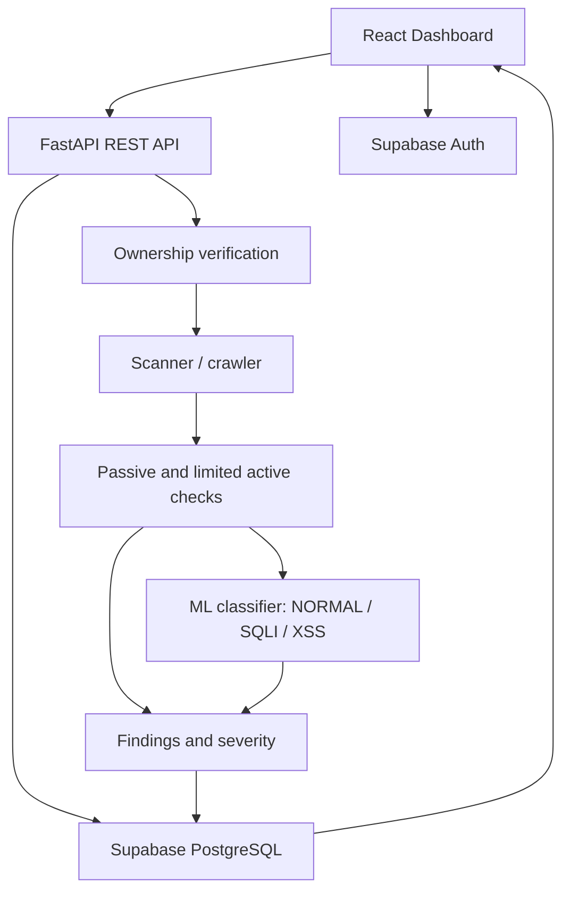

<div align="center">

# ThreatSentry
**A web vulnerability assessment platform with machine-learning-assisted analysis.**

[](https://fastapi.tiangolo.com/)
[](https://react.dev/)
[](https://www.typescriptlang.org/)
[](https://supabase.com/)

[Source Code](https://github.com/kktpx/Threatsentry) · [Issues](https://github.com/kktpx/Threatsentry/issues)

</div>

## Overview

**ThreatSentry** is an educational security platform for assessing **websites you own or are explicitly authorized to test**. A FastAPI backend performs passive and limited active vulnerability checks; a React dashboard displays websites, scans, findings, and risk information. A machine-learning classifier provides supporting context for suspicious request payloads.

ThreatSentry is a **scanner**, not a Web Application Firewall (WAF), and does not block production traffic.

## Core Features

- **Website ownership verification** before scanning.
- **Passive checks** for selected HTTP/security headers, cookies, and information exposure signals.
- **Targeted active checks** for *error-based SQL injection* and *reflected XSS*.
- **Crawling and scan jobs** with scan results and finding details.
- **Risk presentation** with severity and security scoring in the dashboard.
- **ML-assisted payload classification** into `NORMAL`, `SQLI`, and `XSS`.
- **Supabase authentication and storage** for website, scan, and finding records.
- A local deliberately vulnerable test application.

## Technology

| Layer | Stack |
| --- | --- |
| Dashboard | React 19, TypeScript, Vite, Tailwind CSS 4, Recharts |
| API | Python, FastAPI, Uvicorn, Pydantic |
| Scanner | HTTPX, Beautiful Soup, custom passive/active checks |
| Machine Learning | scikit-learn, TF-IDF character n-grams, Logistic Regression, joblib |
| Cloud & Auth | Supabase PostgreSQL, Supabase Auth, Row Level Security |
| Testing | Pytest, Vitest, React Testing Library |

## Architecture



**ML is supporting evidence only:** a classifier prediction is not proof that a vulnerability is exploitable.

## Quick Start

**Requirements:** Python 3.11+, Node.js/npm, and a Supabase project.

### 1. Clone and install

```bash
git clone https://github.com/kktpx/Threatsentry.git
cd Threatsentry
python -m venv .venv
```

Activate the virtual environment:

```powershell
# Windows PowerShell
.\.venv\Scripts\Activate.ps1
```

```bash
# macOS / Linux
source .venv/bin/activate
```

Install dependencies:

```bash
pip install -r backend/requirements.txt
npm install
npm --prefix apps/dashboard install
```

### 2. Configure Supabase

Run [`supabase/migrations/0001_initial_schema.sql`](supabase/migrations/0001_initial_schema.sql) in your Supabase project's SQL Editor.

Create `backend/.env` and `apps/dashboard/.env` from their respective `.env.example` files.

**Backend (`backend/.env`):**

```env
APP_ENV=development
SUPABASE_URL=https://your-project.supabase.co
SUPABASE_ANON_KEY=your-public-key
SUPABASE_SERVICE_ROLE_KEY=your-server-only-key
ALLOWED_ORIGINS=http://localhost:3000
MODEL_PATH=ml/models/web_ids_model_v1.0.0.joblib
SCAN_ALLOW_LOCAL=true
```

**Frontend (`apps/dashboard/.env`):**

```env
VITE_SUPABASE_URL=https://your-project.supabase.co
VITE_SUPABASE_ANON_KEY=your-public-key
VITE_API_URL=http://localhost:8000
```

> **Security:** Never expose `SUPABASE_SERVICE_ROLE_KEY` in frontend variables or commit `.env` files. Local scan permission is intended only for development and must not be enabled in production.

### 3. Run

The root npm scripts target Windows virtual-environment paths:

```bash
npm run dev       # API :8000 + Dashboard :3000
npm run dev:all   # API + Dashboard + vulnerable lab :8080
```

For **macOS/Linux**, start the services in separate terminals after activating `.venv`:

```bash
python -m uvicorn backend.main:app --reload --port 8000
npm --prefix apps/dashboard run dev
python -m uvicorn labs.vulnerable_app:app --reload --port 8080  # optional lab
```

- Dashboard: `http://localhost:3000`
- API documentation: `http://localhost:8000/docs`
- Local lab (optional): `http://localhost:8080`

### 4. Test

```bash
python -m pytest backend/tests
npm --prefix apps/dashboard run test:run
npm --prefix apps/dashboard run build
```

## Repository Layout

```text
Threatsentry/
├── apps/dashboard/       # React dashboard and authentication UI
├── backend/
│   ├── api/              # FastAPI routes and authorization
│   ├── scanner/          # Target validation, crawler, checks, scoring
│   ├── ml/               # Model loading and inference
│   └── tests/            # Backend test suite
├── ml/                   # Training scripts, model artifact, reports
├── labs/                 # Deliberately vulnerable local test app
├── supabase/migrations/  # Database setup
└── docs/                 # Dataset notes
```

## Scope & Limitations

- Active checks currently focus on **error-based SQLi** and **reflected XSS**. This is not a comprehensive pentest suite.
- The crawler does not execute JavaScript or guarantee coverage of authenticated SPA flows.
- The three-class ML model was trained using template-derived examples; strong internal metrics should **not** be interpreted as proven real-world detection accuracy.
- Findings require contextual review. False positives and false negatives are possible.

## Responsible Use

> [!WARNING]
> Run scans **only** against systems you own or have explicit authorization to test. The `labs/` app is intentionally vulnerable and must not be publicly exposed.

## License

See the [MIT License](LICENSE).

---

<div align="center">Developed by <a href="https://github.com/kktpx">kktpx</a>.</div>

## Author
Kittipop Sanpho (กิตติภพ สารโพธิ์)
GitHub:@kktpx

Witthawat Simngam
GitHub:@shiryx0242

 © 2026 ThreatSentry License under MIT
