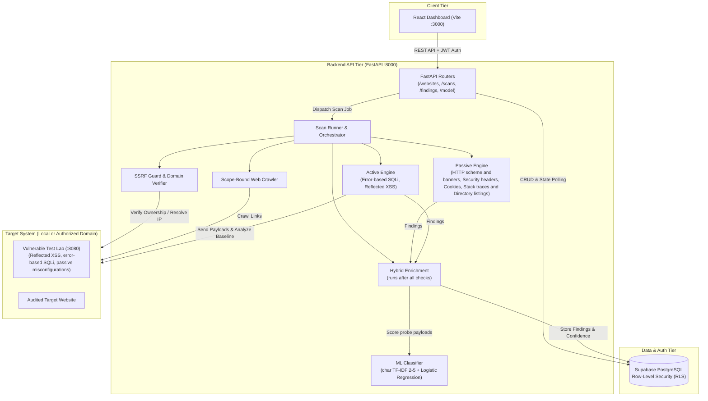

# ThreatSentry — Web Vulnerability Scanner & OWASP ML IDS

<div align="center">


[](https://fastapi.tiangolo.com)
[](https://react.dev)
[](https://tailwindcss.com)
[](https://supabase.com)
[](https://www.python.org)

**A web vulnerability scanner for authorized targets** (university thesis project). It runs passive checks, two active checks (error-based SQL injection and reflected XSS), and uses a 3-class ML payload classifier (`NORMAL` / `SQLI` / `XSS`) as supporting evidence only. It is **not** a WAF. See [Limitations](#limitations) for what the system does not do.

[Quick Start](#installation--setup) • [Architecture](#architecture-overview) • [Walkthrough](#end-to-end-walkthrough-vulnerable-lab-testing) • [ML Model](#machine-learning-ids-details) • [Deployment](#production-deployment-recommendations)

</div>

---

## Table of Contents
- [Architecture Overview](#architecture-overview)
- [Key Features](#key-features)
- [Project Structure](#project-structure)
- [Prerequisites](#prerequisites)
- [Installation & Setup](#installation--setup)
  - [1. Clone Repository](#1-clone-repository)
  - [2. Python Backend Setup](#2-python-backend-setup)
  - [3. Frontend Dashboard Setup](#3-frontend-dashboard-setup)
  - [4. Supabase Database Migration](#4-supabase-database-migration)
  - [5. Environment Variables (.env)](#5-environment-variables-env)
- [Running the Application](#running-the-application)
- [End-to-End Walkthrough (Vulnerable Lab Testing)](#end-to-end-walkthrough-vulnerable-lab-testing)
- [Machine Learning IDS Details](#machine-learning-ids-details)
- [Automated Testing](#automated-testing)
- [Limitations](#limitations)
- [Roadmap (Not Implemented)](#roadmap-not-implemented)
- [Git Configuration & Push Guide](#git-configuration--push-guide)
- [Production Deployment Recommendations](#production-deployment-recommendations)
- [Troubleshooting & FAQ](#troubleshooting--faq)
- [Security & Legal Notice](#security--legal-notice)
- [License](#license)

---

## Architecture Overview



---

## Key Features

1. **Target Management & Safe Domain Ownership Verification**
   - Token verification via `/.well-known/threatsentry.txt` so scans only run against targets the user controls.
   - SSRF protection: a target is rejected unless every resolved address is globally routable (this blocks private ranges and the `169.254.169.254` metadata address). Loopback is allowed only when `SCAN_ALLOW_LOCAL=true`, which is refused when `APP_ENV=production`.

2. **Scope-Bound Crawler**
   - Same-origin crawler. The scan runner fixes it at a maximum of 20 pages, depth 2 and concurrency 3.
   - Skips destructive-looking links (for example `logout` and `delete`). It does not execute JavaScript.

3. **Multi-Phase Vulnerability Scanners**
   - **Passive Security Checks:**
     - Missing security headers: `Content-Security-Policy`, `Strict-Transport-Security`, `X-Frame-Options`, `X-Content-Type-Options`, `Referrer-Policy`, `Permissions-Policy`.
     - Insecure cookie attributes: Missing `Secure`, `HttpOnly`, or weak `SameSite`.
     - Information disclosure: unencrypted HTTP scheme, `Server` / `X-Powered-By` banners, stack traces (Python, PHP, Java, Node.js, .NET) and directory listings in page bodies. It does not probe for files such as `.env` or `.git`.
   - **Active Security Scanners (only two):**
     - **SQL Injection:** error-based only. It sends a single-quote probe, looks for database error strings, and confirms with a quote-pair recovery probe. A separate "potential" finding is raised when a probe turns HTTP 200 into HTTP 500.
     - **Reflected XSS:** sends a unique marker inside a `<script>` payload and checks whether it is reflected unescaped (tag context) or inside an attribute.

4. **ML Payload Classifier**
   - Character TF-IDF plus Logistic Regression, bundled as `ml/models/web_ids_model_v1.0.0.joblib`.
   - Three classes: `NORMAL`, `SQLI`, `XSS`. It returns per-class probabilities only. If the model file cannot be loaded, a keyword heuristic is used instead.
   - Supporting evidence only: it never produces a `CONFIRMED` finding. It can mark a finding `HYBRID` (probability above 0.6) and raise a `POTENTIAL` finding to `LIKELY` (above 0.8).

5. **Security Dashboard**
   - React, Vite and Tailwind CSS UI with scan progress, severity filtering, a finding detail view with recommendation text, and an ML model page with a live prediction box.

6. **Built-in Vulnerable Test Lab**
   - Bundled test lab running on port `8080` for safe offline verification, demonstrations, and test suites.

---

## Project Structure

```text
Threatsentry/
├── .gitignore                   # Ignores secrets, build output and raw ML data
├── package.json                 # Root scripts (dev, dev:all, lab)
├── render.yaml                  # Render service config for the backend
├── requirements.txt             # Root Python requirements
├── docs/
│   └── datasets.md              # How the training data is produced
├── backend/                     # Python FastAPI Backend
│   ├── .env.example             # Backend environment template
│   ├── main.py                  # FastAPI application entry point
│   ├── core/config.py           # Pydantic environment configuration
│   ├── api/
│   │   ├── deps/auth.py         # Bearer-token auth dependency
│   │   └── routers/             # API routes (websites, scans, findings, model)
│   ├── ml/                      # Model loader and predictor (heuristic fallback)
│   ├── scanner/                 # Scanner engine
│   │   ├── runner.py            # Scan job orchestrator
│   │   ├── crawler.py           # Same-origin crawler
│   │   ├── ssrf.py              # SSRF filter and safe IP resolver
│   │   ├── target_validation.py # Target URL normalisation
│   │   ├── verification*.py     # Ownership verification (.well-known)
│   │   ├── baseline.py          # Baseline response capture
│   │   ├── passive/             # Headers, cookies, HTTP scheme/banners, exposure
│   │   ├── active/              # sqli.py (error-based), reflected_xss.py
│   │   └── analysis/hybrid.py   # ML enrichment of findings
│   └── tests/                   # Pytest suite
├── apps/
│   └── dashboard/               # React + Vite + Tailwind Frontend
│       ├── .env.example         # Dashboard environment template
│       └── src/
│           ├── App.tsx          # Routing and application shell
│           ├── lib/api.ts       # API client
│           ├── features/        # Pages (auth, landing, dashboard, websites, findings, model)
│           ├── components/      # Shared components
│           └── **/*.test.tsx    # Vitest tests, next to the code they cover
├── ml/                          # ML training pipeline
│   ├── models/                  # Bundled model and metadata
│   │   ├── web_ids_model_v1.0.0.joblib
│   │   └── web_ids_model_v1.0.0.metadata.yaml
│   ├── reports/                 # Evaluation metrics and report
│   └── scripts/                 # download_datasets, build_dataset, split_dataset, train_model, evaluate_model
├── labs/                        # Local vulnerable application (port 8080)
│   └── vulnerable_app.py        # Reflected XSS, error-based SQLi, passive misconfigurations
└── supabase/
    └── migrations/              # SQL schema with Row-Level Security (RLS)
        └── 0001_initial_schema.sql
```

---

## Prerequisites

- **Python**: Version `3.11` or higher
- **Node.js**: Version `18.0.0` or higher (LTS recommended)
- **npm**: Version `9.0.0` or higher
- **Supabase Account**: Free cloud tier at [supabase.com](https://supabase.com) (or local Supabase CLI)
- **Git**: For version control

---

## Installation & Setup

### 1. Clone Repository

```bash
git clone https://github.com/kktpx/Threatsentry.git
cd Threatsentry
```

### 2. Python Backend Setup

Create and activate a Python virtual environment:

**Windows (PowerShell):**
```powershell
python -m venv .venv
.venv\Scripts\Activate.ps1
```

**Linux / macOS:**
```bash
python3 -m venv .venv
source .venv/bin/activate
```

Install backend dependencies:
```bash
pip install -r backend/requirements.txt
```

### 3. Frontend Dashboard Setup

Install root and dashboard dependencies:
```bash
npm install
npm --prefix apps/dashboard install
```

### 4. Supabase Database Migration

1. Log in to your [Supabase Dashboard](https://app.supabase.com).
2. Create a new project or select an existing one.
3. Navigate to **SQL Editor** in the left sidebar.
4. Copy the entire contents of [`supabase/migrations/0001_initial_schema.sql`](supabase/migrations/0001_initial_schema.sql) and paste it into the editor.
5. Click **Run** to create tables (`websites`, `scan_jobs`, `findings`, `ownership_verifications`) with Row Level Security (RLS) enabled.

### 5. Environment Variables (.env)

#### A. Backend Configuration (`backend/.env`)
Copy the example configuration:
```bash
cp backend/.env.example backend/.env
```
*(On Windows PowerShell: `copy backend\.env.example backend\.env`)*

Edit `backend/.env` with your project credentials:
```env
APP_ENV=development
ALLOWED_ORIGINS=http://localhost:3000
MODEL_PATH=ml/models/web_ids_model_v1.0.0.joblib

# Supabase Credentials (Project Settings -> API)
SUPABASE_URL=https://your-project-id.supabase.co
SUPABASE_SERVICE_ROLE_KEY=your_supabase_service_role_key_here
SUPABASE_ANON_KEY=your_supabase_anon_key_here

# Permit loopback targets (e.g. the lab on :8080). Refused when APP_ENV=production.
SCAN_ALLOW_LOCAL=true
```

> `backend/.env.example` also lists `SCANNER_*` variables (page/depth/concurrency limits). The backend `Settings` class (`backend/core/config.py`) does not read them; crawler limits are hard-coded in `backend/scanner/runner.py`.

#### B. Dashboard Configuration (`apps/dashboard/.env`)
Copy the example configuration:
```bash
cp apps/dashboard/.env.example apps/dashboard/.env
```
*(On Windows PowerShell: `copy apps\dashboard\.env.example apps\dashboard\.env`)*

Edit `apps/dashboard/.env`:
```env
VITE_API_URL=http://localhost:8000
VITE_SUPABASE_URL=https://your-project-id.supabase.co
VITE_SUPABASE_ANON_KEY=your_supabase_anon_key_here
```

---

## Running the Application

### Option 1: One-Command Full Stack (`npm run dev:all`)
Runs the FastAPI Backend (`:8000`), React Dashboard (`:3000`), and Vulnerable Test Lab (`:8080`) simultaneously:
```bash
npm run dev:all
```

### Option 2: Core Platform (`npm run dev`)
Runs only the FastAPI Backend (`:8000`) and React Dashboard (`:3000`):
```bash
npm run dev
```

### Option 3: Manual Execution in Separate Terminals

1. **Terminal 1 — Backend API:**
   ```bash
   .venv\Scripts\python.exe -m uvicorn backend.main:app --reload --port 8000
   ```
   Interactive Swagger documentation available at: `http://localhost:8000/docs`

2. **Terminal 2 — React Dashboard:**
   ```bash
   npm --prefix apps/dashboard run dev
   ```
   Dashboard interface available at: `http://localhost:3000`

3. **Terminal 3 — Vulnerable Test Lab:**
   ```bash
   .venv\Scripts\python.exe -m uvicorn labs.vulnerable_app:app --port 8080
   ```
   Vulnerable application running at: `http://localhost:8080`

---

## End-to-End Walkthrough (Vulnerable Lab Testing)

You can verify the entire scanning, crawling, and ML detection workflow offline using the included Vulnerable Lab:

1. **Open the Dashboard:**
   Navigate to [http://localhost:3000](http://localhost:3000).

2. **Register Target Website:**
   - Click **Add Website**.
   - **Target URL:** `http://127.0.0.1:8080` (or `http://localhost:8080`).
   - Click **Create Website**.

3. **Verify Domain Ownership:**
   - The platform generates an anti-abuse token (e.g. `threatsentry-verification=abc...`).
   - The vulnerable lab automatically serves this token at `http://127.0.0.1:8080/.well-known/threatsentry.txt`.
   - Click **Verify Ownership** in the dashboard. The status updates immediately to **Verified**.

4. **Launch Security Scan:**
   - On the website detail page, click **Launch Scan**.
   - There is a single scan type (`DEEP_SCAN`): crawl, then passive checks, then error-based SQLi and reflected XSS probes, then ML enrichment of the findings.
   - The scan status transitions in real-time from `queued` ➔ `running` ➔ `completed`.

5. **Inspect Security Findings:**
   - Review discovered vulnerabilities categorized by severity (**Critical**, **High**, **Medium**, **Low**).
   - Click on any finding to inspect:
     - Target endpoint and injection parameter.
     - Injected payload and baseline HTTP response comparison.
     - Remediation recommendation text.

6. **ML Model Diagnostic Console:**
   - Navigate to the **ML Model** page in the dashboard.
   - View loaded model metadata (`web_ids_model_v1.0.0`) and its labels.
   - Enter a payload (e.g., `' OR '1'='1`, `<script>alert(1)</script>`) to see per-class probabilities. The model only knows `NORMAL`, `SQLI` and `XSS`, so other attack types (such as path traversal) have no dedicated class.

---

## Machine Learning IDS Details

ThreatSentry includes a small text classifier for request payloads. It is supporting evidence for scanner findings, not a detector on its own.

- **Model:** `TfidfVectorizer(analyzer="char", ngram_range=(2, 5), min_df=2, sublinear_tf=True)` followed by `LogisticRegression`. The training script compared Logistic Regression, a calibrated LinearSVC and an SGD classifier; all three scored validation Macro F1 1.0, and Logistic Regression was kept. The deployed model is **not** probability-calibrated.
- **Classes:** `NORMAL`, `SQLI`, `XSS` (3 classes).
- **Dataset:** 1,853 samples after cleaning and de-duplication, split 1,312 train / 268 validation / 273 test with `GroupShuffleSplit`. The samples are **generated from hand-written templates** by `ml/scripts/download_datasets.py` (the OWASP CRS and CSIC 2010 names describe the style of the templates; no data is downloaded). See [`docs/datasets.md`](docs/datasets.md).
- **Results:**

  | Evaluation set | Macro F1 | Accuracy | Notes |
  | :--- | :--- | :--- | :--- |
  | Project test split (273, template-generated) | 1.0000 | 100.00% | Too high to be meaningful: the test data comes from the same templates as the training data. See `ml/reports/model_evaluation_report.md`. |
  | External HttpParamsDataset | 0.9483 | 97.23% | Reported by the author. The evaluation script, data and metrics file are **not in this repository**, so this number cannot be reproduced from the repo. |

  The external result is the more realistic indicator. No inference-latency or false-positive-rate measurement on real traffic is included.
- **Model Files:**
  - `ml/models/web_ids_model_v1.0.0.joblib` (bundled in git)
  - `ml/models/web_ids_model_v1.0.0.metadata.yaml` (training metadata; its support numbers are for the 268-sample validation split)
- **Re-training (Optional):**
  ```bash
  python ml/scripts/download_datasets.py
  python ml/scripts/build_dataset.py
  python ml/scripts/split_dataset.py
  python ml/scripts/train_model.py
  python ml/scripts/evaluate_model.py
  ```

> [!WARNING]
> **Only load `.joblib` model files from a source you trust.** The backend loads the model with `joblib.load` (`backend/ml/predictor.py`), which uses pickle and can run arbitrary code when a file is loaded. Treat the `MODEL_PATH` setting and any downloaded model file accordingly.

---

## Automated Testing

### Backend Tests (Pytest)
Cover the crawler, SSRF protections, active scanners, passive checks, scoring, and FastAPI routers:
```bash
pytest backend/tests -v
```

### Frontend Tests (Vitest)
Cover page rendering, auth flow and the scan trigger flow, with the API mocked. At the time of writing, `npm --prefix apps/dashboard run test:run` reports 14 passing tests in 9 files on this branch:
```bash
npm --prefix apps/dashboard run test:run
```

### Production Build Test
Verify that TypeScript and CSS compilation pass cleanly:
```bash
npm --prefix apps/dashboard run build
```

---

## Limitations

- **Two active checks only:** error-based SQL injection and reflected XSS. There is no boolean-based, union-based, time-based or stored/DOM XSS testing, and no path traversal / LFI check.
- **Passive checks:** security headers, cookies, HTTP scheme and banners, stack traces and directory listings in crawled pages. It does not look for exposed files such as `.env` or `.git`.
- **Crawler:** at most 20 pages and depth 2, same origin, no JavaScript execution. Parts of an application behind login or rendered client-side are not scanned.
- **ML classifier:** 3 classes only (`NORMAL`, `SQLI`, `XSS`) with a character n-gram TF-IDF and Logistic Regression model.
- **Training data is template-generated.** 1,853 samples come from hand-written templates with prefix/suffix variations, so the project's own test split scores Macro F1 1.0000. That number is inflated and does not predict real-world performance. Group IDs are derived from the first 30 characters of a payload, so close variants of one template can land in different splits.
- **External result:** Macro F1 0.9483 and accuracy 97.23% on HttpParamsDataset are the author's reported figures; the script and data for them are not in this repository.
- **ML is supporting evidence only.** It never turns a finding into `CONFIRMED`. It can set `detection_method` to `HYBRID` and raise a `POTENTIAL` finding to `LIKELY`.
- **Not a WAF.** ThreatSentry scans targets whose ownership has been verified. It does not sit in front of an application or block live traffic.
- **No inference-time or false-positive measurements** on real traffic are included.

---

## Roadmap (Not Implemented)

Ideas that are **not** in the current code:

- Path traversal / local file inclusion checks
- Boolean-based and union-based SQL injection detection
- Additional ML classes such as `command_injection` and `malicious_probe`
- Probability calibration of the classifier
- Training on real OWASP CRS / CSIC 2010 data instead of templates
- Configurable crawler limits (currently hard-coded in the runner)

---

## Git Configuration & Push Guide

This repository has a hardened `.gitignore` configuration designed to keep your secret tokens and temporary artifacts secure:

- **Strictly Ignored (Never Committed):**
  - Secrets: `.env`, `.env.*`, `.env.local`
  - Dependencies: `node_modules/`, `.venv/`, `venv/`
  - Build outputs: `dist/`, `.vite/`, `coverage/`, `.pytest_cache/`, `__pycache__/`
  - Temporary lab files: `labs/threatsentry.txt`, `*.log`
  - Raw ML datasets: `ml/dataset/`
- **Explicitly Tracked:**
  - Environment templates: `backend/.env.example`, `apps/dashboard/.env.example`
  - Pre-trained ML model: `ml/models/web_ids_model_v1.0.0.joblib`, `*.yaml`

### Recommended Git Push Steps

1. Check current git status:
   ```bash
   git status
   ```
2. Verify that NO `.env` files containing real secrets are staged:
   ```bash
   git status -s
   # Real .env files must remain untracked
   ```
3. Stage and commit:
   ```bash
   git add .
   git commit -m "feat: complete ThreatSentry scanner platform with OWASP ML IDS"
   ```
4. Push to remote repository:
   ```bash
   git push origin main
   ```

---

## Production Deployment Recommendations

| Component | Recommended Hosting | Configuration Notes |
| :--- | :--- | :--- |
| **Frontend Dashboard** | **Vercel** / **Cloudflare Pages** | Set build command: `npm run build`, output directory: `dist`. Add `VITE_API_URL`, `VITE_SUPABASE_URL`, `VITE_SUPABASE_ANON_KEY` to dashboard environment variables. |
| **Backend API** | **Railway** / **Render** / **Fly.io** | Deploy with Docker or Python buildpack. Set `APP_ENV=production`; the backend then refuses to start with `SCAN_ALLOW_LOCAL=true` or localhost/wildcard `ALLOWED_ORIGINS`. A `render.yaml` is included. |
| **Database & Auth** | **Supabase Managed Postgres** | Run `0001_initial_schema.sql` migration. Configure Auth redirect URLs to your frontend domain. |

---

## Troubleshooting & FAQ

#### 1. Why does domain verification fail for local targets?
Ensure `SCAN_ALLOW_LOCAL=true` is set in your `backend/.env` file during local testing (loopback addresses only; other private addresses are always rejected). For standard websites, verify that `/.well-known/threatsentry.txt` returns HTTP 200 with the exact verification token text.

#### 2. Can I scan without verifying ownership?
No. ThreatSentry enforces ownership verification by design to comply with safe security testing standards and prevent unauthorized attacks against third-party systems.

#### 3. How do I add custom payloads to the active scanner?
The active checks live in `backend/scanner/active/` (`sqli.py` and `reflected_xss.py`). Each sends a fixed probe per parameter, so adding payloads means editing those functions; there is no payload list or plugin interface. Extra scanners must also be called from `backend/scanner/runner.py`.

---

## Security & Legal Notice

> [!WARNING]
> **Responsible Usage & Ethical Hacking Disclaimer**
> ThreatSentry is designed for authorized vulnerability assessment, security research, and defensive auditing. Only run scans against web applications, domains, and IP addresses that you **own** or have **explicit, written authorization** to test. Unauthorized scanning of third-party infrastructure may violate local computer crime laws and international cyber regulations. The authors assume no liability for misuse of this software.

---

## License

This project is licensed under the [MIT License](LICENSE) — free for educational, personal, and commercial security auditing use.
